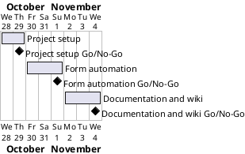

# Project Plan

## Metadata
| Key | Value |
| --- | --- |
| ID | PP-001 |
| CrossReference | [BC-001], [SA-001], [MIL-001], [MIL-002], [MIL-003] |
| Language | en |
| Domain | it |

## Version History
| Date | Status | Author | Reviewer | Change | Commit |
| --- | --- | --- | --- | --- | --- |
| 2026-10-28 | Accepted | Jens Tirsvad Nielsen | AI as stand-in for S01 | Initial version | [e1a3d8d] |

---

## Purpose

This plan schedules three gateways that deliver the Day 48 Selenium form project within the one-week constraint of [BC-001].

## Planning Assumptions

- Week 1 starts 2026-10-28; the plan ends 2026-11-04, per the Business Case constraint.
- Phase length: one to four days, one pull request per phase ([SA-001] concern CN-001).
- The AI works in autonomous mode after the user accepts this plan.

## Gateway Schedule

| Gateway | Document | Window | Decision date | Owner | Stories | Main deliverable | Milestone |
| --- | --- | --- | --- | --- | --- | --- | --- |
| Project setup | [MIL-001] | 2026-10-28 to 2026-10-29 | 2026-10-29 | S01 | none (technical tasks) | Configured repository, skeleton, README, ADR | [M-282] |
| Form automation | [MIL-002] | 2026-10-30 to 2026-11-01 | 2026-11-01 | S01 | none (technical tasks) | Code, tests and screenshots for the three lecture steps | [M-283] |
| Documentation and wiki | [MIL-003] | 2026-11-02 to 2026-11-04 | 2026-11-04 | S01 | none (technical tasks) | README with screenshots and a three-language wiki | [M-284] |



## Scope Coverage

| Business Case scope item | Gateway |
| --- | --- |
| Python package under `src/`, tests, constants | [MIL-002] |
| `pyproject.toml`, venv instructions, `.gitignore`, Doxyfile | [MIL-001] |
| README from the framework template | [MIL-001] (skeleton), [MIL-003] (final) |
| Wiki in English, Danish and Bahasa Malaysia | [MIL-003] |
| Screenshots for each lecture step | [MIL-002] (capture), [MIL-003] (use) |
| Repository description and topics | [MIL-001] |

## Dependencies

```
MIL-001 → MIL-002 → MIL-003
```

A No-Go on a gateway delays every later gateway by the days needed for rework. Only S01 may move the end date 2026-11-04.

## Plan Risks

| Risk | Impact | Mitigation |
| --- | --- | --- |
| The Docker browser run fails | MIL-002 and MIL-003 slip | Fix the image or configuration; stop and report after three failed attempts on one cause |
| Translation takes longer than planned | MIL-003 slips | English is written first; translations follow page by page |
| The git host token lacks scope | Description and topics cannot be set | Stop and report; S01 supplies a token with repository scope |

## Open Issues

- The assignment gives no function names. The plan uses `create_driver`, `click_link_by_text`, `search_for` and `fill_out_form`; S01 may rename them at review.
- The assignment's original form URL is not confirmed to be online; a local fixture is used and the original URL is kept as a constant.
- The repository URL in the request (`Tirsvad-Udemy-100_days_of_code`) differs from `origin` (`Tirsvad-Udemy-100-days-of-code/048-fill-out-form`); the plan uses `origin`.
- No governance document, dictionary or traceability matrix exists yet; the README appendix lists only existing documents.

---

[BC-001]: ./business-case.md
[SA-001]: ./stakeholder-analysis.md
[MIL-001]: ./milestones/mil-001-project-setup.md
[MIL-002]: ./milestones/mil-002-form-automation.md
[MIL-003]: ./milestones/mil-003-documentation.md
[M-282]: https://git.tirsystem.com/Tirsvad-Udemy-100-days-of-code/048-fill-out-form/milestones/282
[M-283]: https://git.tirsystem.com/Tirsvad-Udemy-100-days-of-code/048-fill-out-form/milestones/283
[M-284]: https://git.tirsystem.com/Tirsvad-Udemy-100-days-of-code/048-fill-out-form/milestones/284
[e1a3d8d]: https://git.tirsystem.com/Tirsvad-Udemy-100-days-of-code/048-fill-out-form/commit/e1a3d8d304d4b6ece1a3f95ee02b597e30a97520
