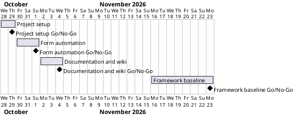

# Project Plan

## Metadata
| Key | Value |
| --- | --- |
| ID | PP-001 |
| CrossReference | [BC-001], [SA-001], [MIL-001], [MIL-002], [MIL-003], [MIL-004] |
| Language | en |
| Domain | education |

## Version History
| Date | Status | Author | Reviewer | Change | Commit |
| --- | --- | --- | --- | --- | --- |
| 2026-10-28 | Deprecated | Jens Tirsvad Nielsen | AI as stand-in for S01 | Initial version | [e1a3d8d] |
| 2026-11-16 | Deprecated | Jens Tirsvad Nielsen | AI as stand-in for S01 | Added the baseline gateway MIL-004 with its schedule row, scope coverage, dependency, risk and Gantt entries; recorded the move of the end date, the domain and the live-site rule in the Planning Assumptions and Open Issues; corrected the open issue about the traceability matrix; set the domain to education; reviewed in autonomous mode, not independent | [90ad973] |
| 2026-11-16 | Accepted | Jens Tirsvad Nielsen | AI as stand-in for S01 | Added the user set-up of `docker/Dockerfile` to the main deliverable of MIL-004; reviewed in autonomous mode, not independent | pending |

---

## Purpose

This plan schedules three gateways that deliver the Day 48 Selenium form project within the one-week constraint of [BC-001], and a fourth, the framework baseline ([MIL-004]), that follows them.

## Planning Assumptions

- Week 1 starts 2026-10-28; the plan ends 2026-11-04, per the Business Case constraint.
- Phase length: one to four days, one pull request per phase ([SA-001] concern CN-001).
- The AI works in autonomous mode after the user accepts this plan.
- The baseline gateway MIL-004 starts 2026-11-16 and ends 2026-11-23, one week (source: [BC-001], Constraints). It brings the finished project to the baseline of the framework, a decision of S01; the first three gateways keep their dates, so the end date of the plan moves from 2026-11-04 to 2026-11-23 because of it.
- For MIL-004 S01 has authorised the assistant to commit, push, open the pull request and merge it, and the review is done by an AI stand-in for S01 (source: [BC-001], Constraints and Risks).

## Gateway Schedule

| Gateway | Document | Window | Decision date | Owner | Stories | Main deliverable | Milestone |
| --- | --- | --- | --- | --- | --- | --- | --- |
| Project setup | [MIL-001] | 2026-10-28 to 2026-10-29 | 2026-10-29 | S01 | none (technical tasks) | Configured repository, skeleton, README, ADR | [M-282] |
| Form automation | [MIL-002] | 2026-10-30 to 2026-11-01 | 2026-11-01 | S01 | none (technical tasks) | Code, tests and screenshots for the three lecture steps | [M-283] |
| Documentation and wiki | [MIL-003] | 2026-11-02 to 2026-11-04 | 2026-11-04 | S01 | none (technical tasks) | README with screenshots and a three-language wiki | [M-284] |
| Framework baseline | [MIL-004] | 2026-11-16 to 2026-11-23 | 2026-11-23 | S01 | none (technical tasks) | Branch `mil-004-framework-baseline` merged: the adopted framework release, the wiki sidebar in the framework's shape, the README, licence and project URL metadata, review records, the traceability matrix and a container user without root rights | [M-563] |



## Scope Coverage

| Business Case scope item | Gateway |
| --- | --- |
| Python package under `src/`, tests, constants | [MIL-002] |
| `pyproject.toml`, venv instructions, `.gitignore`, Doxyfile | [MIL-001] |
| README from the framework template | [MIL-001] (skeleton), [MIL-003] (final) |
| Wiki in English, Danish and Bahasa Malaysia | [MIL-003] |
| Screenshots for each lecture step | [MIL-002] (capture), [MIL-003] (use) |
| Repository description and topics | [MIL-001] |
| The baseline: framework release, wiki sidebar, README, licence and project URL metadata, review records | [MIL-004] |

## Dependencies

```
MIL-001 → MIL-002 → MIL-003 → MIL-004
```

A No-Go on a gateway delays every later gateway by the days needed for rework. Only S01 may move the end date; for MIL-004 it moved from 2026-11-04 to 2026-11-23.

## Plan Risks

| Risk | Impact | Mitigation |
| --- | --- | --- |
| The Docker browser run fails | MIL-002 and MIL-003 slip | Fix the image or configuration; stop and report after three failed attempts on one cause |
| Translation takes longer than planned | MIL-003 slips | English is written first; translations follow page by page |
| The git host token lacks scope | Description and topics cannot be set | Stop and report; S01 supplies a token with repository scope |
| A continuous integration (CI) check fails on the pull request of MIL-004 | The merge is delayed past 2026-11-23 | The failure is fixed on the same branch and the checks run again; after three failed rounds on one cause the work stops and S01 decides (trace: success criterion 7 of [BC-001]) |

## Open Issues

- The assignment gives no function names. The plan uses `create_driver`, `click_link_by_text`, `search_for` and `fill_out_form`; S01 may rename them at review.
- The assignment's original form URL is not confirmed to be online; a local fixture is used and the original URL is kept as a constant.
- The repository URL in the request (`Tirsvad-Udemy-100_days_of_code`) differs from `origin` (`Tirsvad-Udemy-100-days-of-code/048-fill-out-form`); the plan uses `origin`.
- No governance document or dictionary exists; the README appendix lists only existing documents. (The traceability matrix TM-001 was created in MIL-001; the earlier text that said it did not exist yet is corrected here.)
- The Gateway Schedule links the milestones of the git host that existed; the baseline milestone is linked after the sync.
- Domain: since [MIL-004] the plan, the Business Case and the baseline milestone have the domain `education`. The other documents (Stakeholder Analysis, milestones MIL-001 to MIL-003 and the review records RC-001 to RC-011) keep the domain `it` they were accepted with; they are not changed by the baseline, and a change of their domain would need a new review of each.
- Live services: running the program opens real web pages (the Wikipedia main page and the course's demo sign-up form) and clicks the sign-up button with the values the user gives. MIL-004 opens no live page, submits no form and runs no browser; the tests use fakes and a local copy of the form. The reader checks the terms of a site before running the program against it and uses their own address, not another person's data.

---

[BC-001]: ./business-case.md
[SA-001]: ./stakeholder-analysis.md
[MIL-001]: ./milestones/mil-001-project-setup.md
[MIL-002]: ./milestones/mil-002-form-automation.md
[MIL-003]: ./milestones/mil-003-documentation.md
[M-282]: https://git.tirsystem.com/Tirsvad-Udemy-100-days-of-code/048-fill-out-form/milestones/282
[M-283]: https://git.tirsystem.com/Tirsvad-Udemy-100-days-of-code/048-fill-out-form/milestones/283
[M-284]: https://git.tirsystem.com/Tirsvad-Udemy-100-days-of-code/048-fill-out-form/milestones/284
[e1a3d8d]: https://git.tirsystem.com/Tirsvad-Udemy-100-days-of-code/048-fill-out-form/commit/e1a3d8d304d4b6ece1a3f95ee02b597e30a97520
[MIL-004]: ./milestones/mil-004-framework-baseline.md
[M-563]: https://git.tirsystem.com/Tirsvad-Udemy-100-days-of-code/048-fill-out-form/milestones/563
[90ad973]: https://git.tirsystem.com/Tirsvad-Udemy-100-days-of-code/048-fill-out-form/commit/90ad973aec2f4c57daaa1ec1dbc194932214cce0
